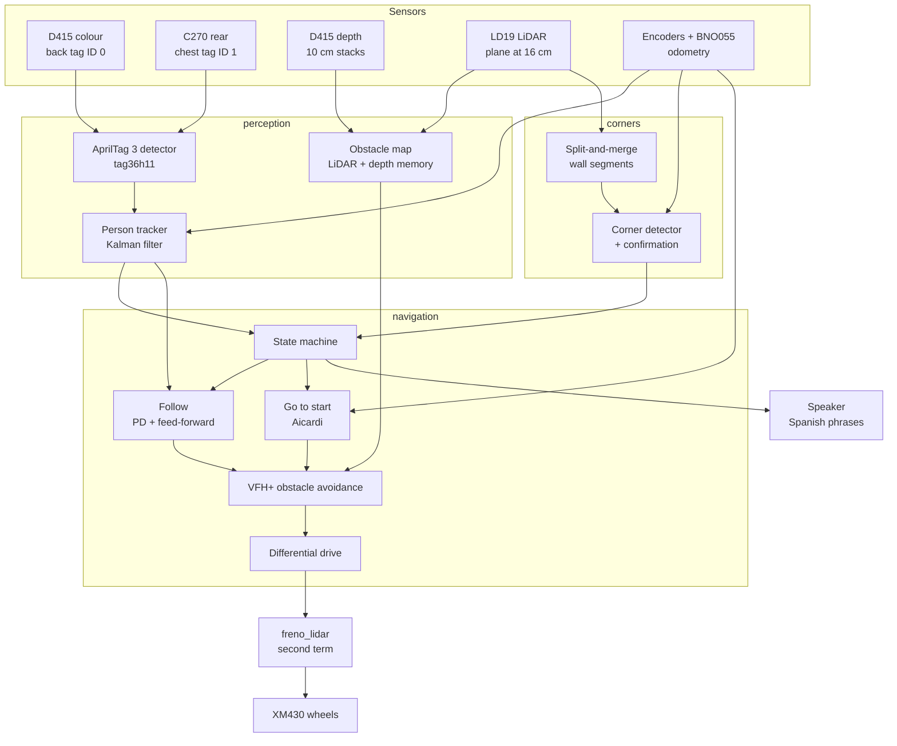

# Conventional control

The control that runs on the robot for the exam. Classic algorithms, each from a well-known paper, connected
by a state machine. The neural architecture ([`neural_architecture.md`](neural_architecture.md)) stays in the
repository to replace pieces of this one later.

The logic is plain Python without ROS (`software/src/perception`, `corners`, `navigation`). On the robot a thin
ROS 2 node feeds it the sensor messages (`software/src/bringup`); in simulation MuJoCo feeds it rendered camera
images and simulated scans (`simulation/run_conventional.py`). **Both run the same code.**

## States

| State | When it starts | What the robot does | Speaker |
|-------|----------------|---------------------|---------|
| FOLLOW | start; tag seen again | Waits until the back tag is seen, then drives towards the person, 0.9 m from the back tag; VFH changes the direction around obstacles | "Sígueme" (first time), "Te encontré", "Ten cuidado con los obstáculos" |
| LOST | back tag unseen for > 0.5 s | Stops at once; for 5 s turns the front camera towards the last estimate, then sweeps slowly in place | "No te veo, espérame", every 6 s |
| SIGNAL | far corner confirmed by the LiDAR | Stops for 3 s | "Fase uno completa. Ahora te guío de regreso" |
| TURN_AROUND | after the signal | Turns in place towards the start; the person tracker restarts with the chest tag | – |
| GUIDE | rear camera sees the chest tag and the robot faces the start | Drives to the start (odometry), VFH around obstacles, slows down if the person falls behind | "Sígueme", "Te encontré" |
| WAIT_PERSON | person > 1.2 m away or chest tag unseen for > 2.5 s | Stops; for 5 s turns the rear camera towards the person, then sweeps | "Te espero", every 6 s |
| DONE | odometry within 0.25 m of the start, or the LiDAR sees the start corner at the start distance (also from WAIT_PERSON) | Stops | "Llegamos. Fin del recorrido" |

The state diagram with these transitions is the Archify diagram made for the proposal; the code is in
`software/src/navigation/navigation/state_machine.py`.

## Each block and its reference

| Block | File | What problem it solves | Reference |
|-------|------|------------------------|-----------|
| AprilTag detection | `perception/apriltag_detector.py` | Identify *our* person (ID) and measure distance and bearing from one image, robust to motion blur and partial views | Olson 2011; Wang & Olson 2016; Krogius et al. 2019 |
| Kalman filter | `perception/person_tracker.py` | Smooth the tag poses, predict the person during short occlusions, reject wrong detections, estimate their speed | Welch & Bishop 2006 |
| Depth obstacles + memory | `perception/depth_obstacles.py`, `obstacle_map.py` | See the 10 cm stacks the LiDAR misses, and remember them (20 s) when they leave the camera's 65° view | engineered |
| Split-and-merge | `corners/line_extraction.py` | Wall segments from the scan | Nguyen et al. 2007 |
| Corner detector | `corners/corner_detector.py` | Recognise the far corner by the robot itself (rule of the exam), confirm the start corner | engineered on Nguyen et al. 2007 |
| Follow controller | `navigation/controllers.py` | Keep 0.9 m behind the person, aim at where they are | Gockley et al. 2007 |
| Go-to-goal | `navigation/controllers.py` | Drive back to the start corner with a proven stable law | Aicardi et al. 1995 |
| VFH+ | `navigation/vfh.py` | Choose a free direction close to the desired one; slow down near obstacles | Borenstein & Koren 1991; Ulrich & Borenstein 1998 |
| Differential drive | `navigation/diff_drive.py` | (v, ω) ↔ wheel speeds, with saturation that keeps the curvature | Siegwart et al. 2011 |

Full references with links: [`references.md`](references.md#conventional-control).

## Frames

- **Robot frame:** x forward, y left, z up, origin between the wheels on the floor.
- **Odometry frame:** the robot frame at the start. The far corner is straight ahead (≈ 9.05 m in a 7 m room
  when the robot starts 0.85 m from its corner) and the start corner is behind (≈ −0.85 m). The corner detector
  uses these positions only as loose priors (2.5 m and 1 m tolerance), so a pair of obstacles in the middle of
  the room is not taken as a corner.
- **Camera optical frame:** x right, y down, z out of the lens (OpenCV / AprilTag convention). Each camera's
  pose on the robot is a parameter (`software/src/bringup/config/social_nav.yaml`).

## On the robot

The node runs on top of the base robot of the second term (`wallens` service): it reads `odometry/filtered`
(EKF of wheels and BNO055) and `scan`, and its `cmd_vel` goes through the second-term LiDAR brake
(`freno_lidar` → `cmd_vel_safe` → driver) before the wheels. On the robot the differential-drive block is the
second-term driver; `diff_drive.py` is used by the simulation. Details: [`../software/README.md`](../software/README.md#on-the-robot).

## How it is tested

1. **Unit tests** (`cd software/src && python -m pytest`): geometry of the camera mounts, Kalman filter,
   depth obstacles, obstacle memory, line and corner extraction, VFH, go-to-goal convergence, the state
   machine through a whole exam, the sound files.
2. **Simulation** (`python -m simulation.run_conventional`, `python -m simulation.batch_conventional`):
   the person's signs carry real tag36h11 images, the D415 colour and C270 images are rendered and passed to
   the same AprilTag detector, and the D415 depth image to the same depth code. Results in
   [`../simulation/README.md`](../simulation/README.md#conventional-controller).
3. **Robot:** each driver first on its own, then the whole controller; see
   [`../software/README.md`](../software/README.md).
