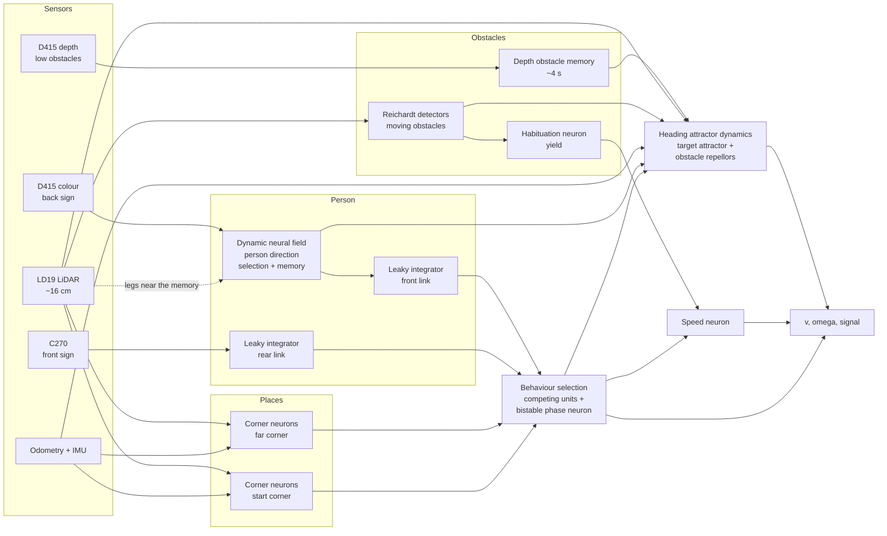

# Neural architecture

The whole control of the robot, for both exam phases, is a set of hand-written neural structures connected
in `neural/models/social_nav_net.py`. It runs at ~20 Hz and does not depend on MuJoCo or ROS.

## Behaviours

| Behaviour | When it wins | What the robot does |
|-----------|--------------|---------------------|
| FOLLOW | phase 1, front link on | Heading attracted to the person's direction (field peak), speed from the distance error (target 0.9 m to the sign) |
| SEARCH | phase 1, front link lost | Stops (the person is asked to stop) and turns towards the remembered direction |
| SIGNAL | phase 1, far corner recognised | Stops and blinks the signal light for 3 s; then the phase neuron switches to phase 2 |
| GUIDE | phase 2, person behind and close | Heading attracted to the start corner (odometry), slows down when the person lags |
| WAIT | phase 2, person lost or too far | Stops, turning in place towards the start corner |
| DONE | phase 2, start corner reached | Stops and gives the signal |

## Why each block, and where it comes from

| Block | Exam problem it solves | Reference |
|-------|------------------------|-----------|
| Dynamic neural field of the person's direction | People crossing (keep the right person), the person hidden for a moment (memory), the person lost for good (forgetting) | Amari 1977; Bicho, Mallet & Schöner 2000 |
| Leaky integrators (links) | Do not declare the link lost on a single missed frame, do declare it after a few seconds | Usher & McClelland 2001 |
| Heading attractor dynamics | Go to the person / start corner and avoid static and moving obstacles at the same time | Schöner, Dose & Engels 1995; Bicho et al. 2000; Monteiro & Bicho 2010 |
| Reichardt detectors + habituation | Notice moving people and briefcases; yield to someone crossing, but not forever | Hassenstein & Reichardt 1956; Borst & Euler 2011 |
| Corner neurons | "The robot itself must recognise the corner" (end of phase 1), and correct the odometry at the start corner | Engineered template |
| Behaviour selection | One coherent behaviour at a time, no flicker, the phase remembered | Redgrave, Prescott & Gurney 1999; Prescott et al. 2006 |

Details and links: [`references.md`](references.md). Results in simulation: [`../simulation/README.md`](../simulation/README.md).
