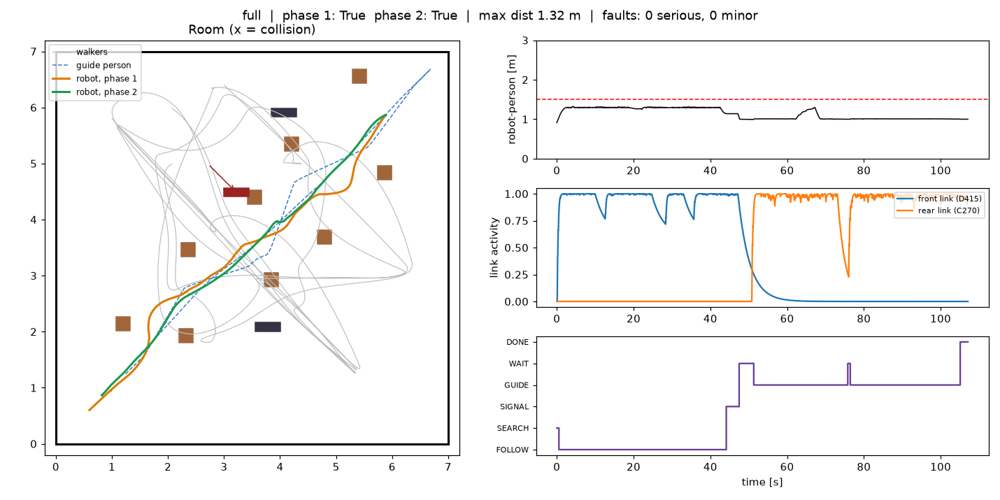

# Simulation

Simulated 7 m × 7 m room with obstacles and people (MuJoCo), used to test the controllers before they go on
the real robot:

- the **conventional controller** in [`../software`](../software) (what the robot runs for the exam), with
  `run_conventional.py`, see [below](#conventional-controller);
- the **neural architecture** in [`../neural`](../neural), with `run_exam.py`.

## Robot model with both cameras

`xml 2 cameras set.xml` is the robot exported from the Onshape CAD, with the front Intel RealSense D415
(depth 65° × 40°, color 69° × 42°) and the rear Logitech C270 (~48.8° × 28.6°). Meshes are in `assets/`.

```bash
pip install mujoco
python -m mujoco.viewer --mjcf="simulation/xml 2 cameras set.xml"
```

- `]` / `[` switch to the camera views (`d415_prof`, `d415_color`, `c270`).
- Key `3` shows the 1.5 m view frustums.
- Wheel velocity motors `motor_izq`, `motor_der` (rad/s); forward = `motor_izq` negative, `motor_der` positive.
- The two caster wheels (`part_1__6`, front and rear) have frictionless contacts (`condim="1"`): with the
  default mesh friction the chassis dragged and the robot barely moved. Measured now: 0.185 m/s for
  5 rad/s at the wheels (wheel radius 37.5 mm), effective track 0.29 m.

## Conventional controller

`run_conventional.py` runs `software/src/navigation/navigation/navigator.py`, **the same code as the ROS 2
node**, and gives it what the real sensors would:

- the person's signs carry real **tag36h11** images (ID 0 on the back, ID 1 on the chest, black square 16 cm);
  the D415 colour and C270 images are **rendered** (640 × 360) and passed to the robot's AprilTag detector;
- the D415 **depth image is rendered** and passed to the robot's depth-obstacle code;
- the LD19 scan and the odometry come from `sensors.py`, as for the neural architecture.

```bash
.venv/bin/pip install -r simulation/requirements.txt
.venv/bin/python -m simulation.run_conventional --scenario full --seed 0      # plot + JSON in simulation/results/
.venv/bin/python -m simulation.run_conventional --scenario full --view        # watch it in the MuJoCo viewer
.venv/bin/python -m simulation.batch_conventional --seeds 6                   # every scenario, Markdown table
```

Rendering needs OpenGL; without a display the scripts use `MUJOCO_GL=egl`. A run takes about one minute.

### Results (6 seeds per scenario, 2026-11-27, rules of the exam plan)

LOST after 0.5 s without the tag (the robot stops at once), 5 s turning towards the last bearing before the
sweep, spoken alerts.

| Scenario | Both phases done | Link losses (phase 1) | Waits (phase 2) | Serious faults | Minor faults | Max distance [m] | Time > 1.5 m [s] | Start error [m] | Mean time [s] |
|---|---|---|---|---|---|---|---|---|---|
| empty | 6/6 | 0 | 6 | 0 | 0 | 1.40 | 0.0 | 0.29 | 86 |
| static | 6/6 | 74 | 12 | 0 | 0 | 1.40 | 0.0 | 0.28 | 102 |
| moving | 6/6 | 74 | 12 | 0 | 0 | 1.40 | 0.0 | 0.28 | 102 |
| people | 6/6 | 94 | 13 | 0 | 0 | 1.40 | 0.0 | 0.28 | 111 |
| full | 6/6 | 94 | 13 | 0 | 0 | 1.40 | 0.0 | 0.28 | 111 |

No collisions. Losses and waits are summed over the 6 seeds. A "link loss" is every time the back tag goes
unseen for more than 0.3 s, however short; it is not the rubric's loss of the link (that tolerates 5 s).

- **30/30 runs complete both phases**; the person is never more than 1.4 m away in phase 2 (limit 1.5 m).
- With LOST at 1.5 s (the robot kept following the Kalman prediction) there were 35 / 41 losses and runs were
  4–9 s shorter. Stopping at 0.5 s, as the plan asks, doubles the short losses: the robot stops, the person
  keeps walking a step and leaves the view for a moment.
- **Depth memory matters.** With a 4 s memory a stack that left the D415 view was forgotten while the robot
  turned and it touched one (minor fault). A 20 s memory alone left "ghost" points where the person had walked
  (128 losses, 2 runs not completed). The final version keeps a depth point only if the LiDAR has nothing
  within 0.25 m of it (the LiDAR already sees people and walls), and clears it when the camera looks again.
- `moving` equals `static` and `full` equals `people`: in these layouts the moving briefcase never crosses the
  robot's path. A layout where it does is still to be added.
- The simulation runs with `v_follow` 0.22 m/s; on the robot the second-term driver caps it at 0.19 m/s
  (`config/social_nav.yaml`).

## Running the neural architecture in simulation

From the repository root:

```bash
python -m venv .venv && .venv/bin/pip install -r simulation/requirements.txt
.venv/bin/python -m simulation.run_exam --scenario full --seed 0          # both phases, plot + JSON in simulation/results/
.venv/bin/python -m simulation.run_exam --scenario full --view            # watch it in the MuJoCo viewer
.venv/bin/python -m simulation.batch --seeds 8                            # many seeds + ablations, Markdown table
```

Scenarios: `empty`, `static` (9 stacks of 10 cm + 2 briefcases), `moving` (+ a briefcase pushed during the
run), `people` (static + 2 people walking across the diagonal), `full` (everything). Each seed changes the
stack layout, and the noise of the sensors. Ablations: `--no-memory`, `--no-motion`.



## What is simulated

| File | Contents |
|------|----------|
| `world.py` | Builds the room around the unchanged robot XML with MjSpec: walls, tablet stacks, briefcases, people with their signs, a signal light on the robot (used only by the neural simulation, `run_exam.py`; the conventional controller gives every signal on the speaker). |
| `sensors.py` | LD19 LiDAR at ~16 cm (360 rays, 10 Hz, does **not** see the 10 cm stacks), D415 depth (ray grid in its field of view, sees the stacks), sign cameras (D415 colour at the front, C270 at the rear), odometry (wheel encoders + IMU yaw with drift). |
| `people.py` | The guide person (walks ahead and stops if the robot falls behind, then walks behind the robot in phase 2, with a pause to test waiting) and walkers driven by a social force model (Helbing & Molnár 1995). |
| `run_exam.py` | Control loop at 20 Hz: sensors → `SocialNavNet` → wheel speeds. Measures the rubric: robot–person distance, collisions (serious / during a manoeuvre), link losses, corner, return to start, time. |
| `batch.py` | Runs many seeds and the ablations, prints the results table. |
| `cameras.py` | Rendered camera images (grey and depth) and each camera's pose on the robot, for the conventional controller. |
| `run_conventional.py`, `batch_conventional.py` | The same loop and metrics with the conventional controller; many seeds and scenarios. |
| `software_path.py` | Makes `software/src` importable without building the ROS workspace. |

For the neural architecture the sign "detector" is geometric: the sign counts as seen if its centre is inside the camera's field of view,
within range, facing the camera and not occluded. The real QR/pattern detection must be tested on the robot.

## Results of the neural architecture (8 seeds, `full` scenario)

| Variant | Both phases done | Link losses (phase 1) | Serious faults | Minor faults | Max distance [m] | Time > 1.5 m [s] | Mean time [s] |
|---|---|---|---|---|---|---|---|
| full architecture | 7/8 | 0 | 38 | 8 | 1.41 | 0.0 | 169 |
| without field memory | 2/8 | 44 | 0 | 0 | 1.36 | 0.0 | 334 |
| without Reichardt detector | 8/8 | 0 | 0 | 0 | 1.38 | 0.0 | 128 |

- The robot never went beyond 1.5 m from the person in any run.
- The 38 serious faults of the full architecture all come from **one** seed (6): after brushing a stack
  several times the odometry drifts and the robot ends up pushing against the start corner walls.
- **The field memory is essential**: without it the link is lost 44 times and phase 1 fails in 6 of 8 runs.
- **The Reichardt detector does not help in these scenarios** (the simulated walkers already avoid the robot).
  It is still on by default; see the open points in [`../neural/README.md`](../neural/README.md).

## Findings that matter for the real robot

- **Height of the signs.** The D415 is ~10 cm above the floor and looks almost horizontally (~5° up), so with
  its 42° vertical field of view it only sees up to ~0.5 m high at 1 m. In simulation the **back sign is at
  0.30 m** (visible from ~0.8 m to beyond 2.5 m). Alternatives: tilt the D415 upwards ~15–20°, or put the
  back sign low (calf/knee height).
- The C270 looks ~47° upwards from 15 cm: a **front sign at ~1.10 m** is seen between ~0.9 m and 1.8 m.
- Collisions make the wheels slip and the odometry drift; in phase 2 the start corner is confirmed with the
  LiDAR (both walls close) instead of trusting only the odometry.
